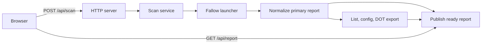

# Architecture

Code Shame runs a local HTTP server around Fallow and serves a browser dashboard.
There is no frontend build step. Node.js uses CommonJS in `src`; the browser uses
native ES modules in `public/app`. `public/app/package.json` also lets Node import those
modules directly in tests without changing the backend module format.

## Module boundaries

| Area                | Modules                                                                                                                                                         | Responsibility                                                                                            |
| ------------------- | --------------------------------------------------------------------------------------------------------------------------------------------------------------- | --------------------------------------------------------------------------------------------------------- |
| CLI                 | `src/start.js`                                                                                                                                                  | Reads environment settings, listens on a port, handles shutdown.                                          |
| HTTP                | `src/server.js`, `src/paths.js`                                                                                                                                 | Creates a server, routes API requests, serves the public directory and vendor scripts.                    |
| Scan lifecycle      | `src/scanService.js`                                                                                                                                            | Owns one project's snapshot, active scan, cancellation, and project identity.                             |
| Process adapter     | `src/fallowClient.js`                                                                                                                                           | Runs the installed Fallow launcher, parses JSON, enforces command deadlines, terminates its process tree. |
| Analysis            | `src/fallowReport.js`, `src/architectureAnalyzer.js`, `src/concurrency.js`                                                                                      | Normalizes primary results and performs bounded file inspections.                                         |
| Graph model         | `src/projectArchitecture.js`                                                                                                                                    | Builds a canonical file dependency graph and projects a representative subset for the dashboard.          |
| Browser bootstrap   | `public/app/main.js`                                                                                                                                            | Connects DOM elements, navigation, renderers, and scan controls.                                          |
| Scan controls       | `public/app/features/scan/scan-controller.js`                                                                                                                   | Owns HTTP requests, polling, auto-refresh timers, busy state, and disposal.                               |
| Report presentation | `public/app/features/report/report.js`, `public/app/features/report/overview.js`, `public/app/features/report/findings.js`, `public/app/shared/utils/format.js` | Renders report sections, metric charts, and copyable text.                                                |
| Browser state       | `public/app/features/report/metric-history.js`                                                                                                                  | Stores up to 24 metric samples per project in localStorage.                                               |
| Graph presentation  | `public/app/features/architecture/architecture.js`, `public/app/features/architecture/graph/`                                                                   | Binds focus/details behavior; graph adapters create Cytoscape elements and styles.                        |
| Design tokens       | `public/styles/tokens/index.css`, `public/app/shared/design/tokens.js`                                                                                          | Defines visual primitives once; graph adapters read the current computed root tokens.                     |
| UI support          | `public/app/shell/navigation.js`, `public/app/shared/utils/icons.js`, `public/app/shared/utils/copy.js`, `public/app/shared/utils/html.js`                      | Provides navigation, vendor icon integration, clipboard handling, and HTML escaping.                      |
| Demo                | `public/app/features/scan/demo.js`                                                                                                                              | Provides sample reports and graph fixtures without writing them to metric history.                        |

Application modules use explicit imports and exports. Cytoscape, Dagre and Lucide are
vendor UMD scripts; their globals are used only by their presentation adapters.
The graph model does not depend on Cytoscape or browser APIs.

Browser features live under `app/features/{architecture,explorer,report,scan,source}`.
Each feature owns its controllers and presentation; `app/shell` owns page navigation.
Shared components and utilities do not import feature controllers. Source call-graph
styles live with the source feature; project-graph styles live with architecture.

### Workspace and source ownership

`architecture/architecture.js` composes the workspace and owns its canonical
project, file, directory, mode, page, layer, and cycle selection. It passes state
snapshots and setters to the extracted modules. `navigation/workspace-transitions.js`
coordinates selection and mode changes; `workspace-history.js` parses and writes
URLs and history, gates writes until navigation is ready, and stores camera and
source state. `workspace-restoration.js` applies locations, graph filters, and
source state, including canonicalizing directory pages.

`components/organisms/workspace-browser.js` renders the workspace shell and
inventory. In `architecture/graph/`, `graph-view.js` projects data,
`graph-controls.js` renders controls and diagnostics, and `graph-presenter.js`
coordinates drawing and interactions with the graph inspector. `graph-runtime.js`
owns Cytoscape lifecycle, layout, camera, resizing, and layer focus; history
persists the camera only for the matching graph context.

`source/source-explorer.js` coordinates source and function-graph views.
`source-requests.js` gives each request type its own abortable, sequenced channel
so stale responses cannot replace current results. `source-identity.js` checks
saved state and call-site identity, including source hashes. `source-restoration.js`
handles focus and scroll restoration; `source-dom.js` supplies shared DOM helpers,
while source organisms render the workspace and code. The source graph runtime
owns its own Cytoscape lifecycle.

### Function resolution

`src/functionResolver.js` composes a resolver for a root and snapshot. Its
`function-resolver/source-repository.js` restricts relative paths to snapshot files,
loads and parses them through a per-resolver promise cache, and reports its
40-file coverage limit and diagnostics. `call-targets.js` coordinates binding and
call resolution; `esm-exports.js`, `commonjs.js`, and `class-targets.js` own
separate ESM export, CommonJS, and class/`this` proof rules. `symbols.js` supplies
shared symbol and property helpers. Resolution is conservative when a target
cannot be proven. `function-graph.js` gathers calls from the selected file and
bounded transitive snapshot importers, reporting coverage, truncation, and
unresolved calls rather than claiming a complete runtime call graph.

### Styles and components

`public/styles/main.css` is the ordered stylesheet entry point. It loads tokens,
base rules, application layout, shared `components/`, and feature styles in
`features/`. `components/molecules/styled-select.css` is the separate shared select stylesheet.
Keep import order explicit: responsive rules and later feature overrides depend on it.

Atomic components follow their actual responsibilities: `components/atoms` contains
control primitives, `components/molecules` owns the accessible select and its styles,
and `components/organisms` contains composed report panels. Feature-specific organisms,
such as graph details, stay inside their feature. Reuse the shared component rather
than recreating its markup, keyboard behavior, or styles in a feature.

Change colors, type, spacing, radii, and shadows in `tokens/index.css`. Component rules
reference those tokens; viewport breakpoints and graph geometry stay with their
layout. Canvas graphs read computed tokens when created, so they share the same
palette and typography as HTML. User-configured boundary colors remain model data.
The token tests check stylesheet imports, missing custom properties, and token
changes reaching both Cytoscape adapters.

## Public and server code

`public` is the complete, directly served browser application. Its root holds
`index.html`, `app/` holds JavaScript modules, and `styles/` holds CSS. Keep server-only code and secrets outside it. Static
paths are constrained to this directory. The vendor routes expose only the
resolved Cytoscape, Dagre and Lucide scripts, not the whole node_modules directory.

`src` contains Node.js code and is not served to the browser. Importing
`src/server.js` exports `createServer(options)` without opening a port or
registering process signal handlers. Each server gets its own scan service;
tests can inject a service at this boundary.

The CLI never reads PID files or stops another process. If its requested port is
occupied, it exits with an error. On SIGINT or SIGTERM it closes its own server;
the server's close event cancels its active scan.

## Scan lifecycle and API

- `GET /api/health` returns `{ ok: true }`.
- `POST /api/scan` starts a scan and returns its snapshot with HTTP 202. Requests
  during an active scan share that work.
- `GET /api/report` returns `projectId`, `state`, `report`, `error`, `startedAt`,
  `finishedAt`, and `running`.

`state` is `idle`, `running`, `ready`, or `failed`. It becomes `ready` as soon as
the primary analysis is available. At that point `report.architecture.state` can
still be `running`, and the top-level `running` remains true. The browser polls
every 1.5 seconds until all analysis settles. `finishedAt` records that moment;
`report.generatedAt` identifies the primary report for metric samples.

An architecture failure produces a local `state: "failed"` graph value and keeps
the primary report. A primary failure sets the snapshot state to `failed` and
retains the previous report when available.

Each command has a 60-second deadline; the entire scan has a 180-second deadline.
Shutdown cancels active commands. The launcher delegates platform, architecture,
libc selection, and binary verification to Fallow. Since it owns a native child,
cancellation terminates the process group on POSIX or uses `taskkill /T` on
Windows. Exit codes 0 and 1 may carry reports; other exit codes and signal exits
are failures.

## Project identity and metric history

The scan service hashes the absolute project root into a stable `projectId`.
The browser stores metrics under `code-shame:metrics:<projectId>`, so projects
served from the same origin do not share comparisons. Repeated polling of the
same report does not add samples. A new report adds a sample even when its
values are unchanged. Corrupt, unavailable, or full storage does not prevent
rendering.

The old metric cookie is deliberately ignored: it has no project identity and
cannot be migrated safely. Auto-refresh preferences remain a shared cookie.
Demo data is displayed without persisting samples.

## Graph construction

The architecture analyzer requests Fallow's file list and resolved config, then
exports one DOT graph with pinned Fallow 3.37.0. A DOT parser validates its file
labels against the list before projecting the graph. On export or validation
failure, it inspects visible files with four workers and marks the graph partial.
`ARCHITECTURE_MAX_FILES` defaults to 48; the CLI accepts integers from 1 through
1000 and applies the limit only to the dashboard projection.

Configured Fallow boundary zones take precedence over automatic path-based
categories. File selection balances layers and prioritizes entry points,
coupling, size, and low maintainability. Hidden files become summary nodes.

The `report.architecture.projectGraph` field is the canonical graph, with
`schemaVersion: 1`, `complete`, `diagnostics`, file nodes and directed edges from
importer to imported file. Paths use forward slashes without leading `./`.
Edges have `kind: "unknown"` and `provenance: "fallow"` and are deduplicated by
source, target and kind. `complete` means the resolved file-level graph for
Fallow's discovered files, not all possible runtime imports or external package
dependencies. It requires the DOT node set to match the file list and no Fallow
analysis-degrading diagnostics or unresolved imports. The DOT format does not
identify import kinds. The pinned version's contract fixture checks aliases,
workspace imports, dynamic and type-only imports, re-exports, require, cycles,
and isolated files against `inspect`. An unresolved import has no file edge and
makes the graph partial. On fallback, missing traces and unknown endpoints are
also reported; a failed DOT export always leaves the graph partial.

DOT output is limited to 16 MiB and command output to 4 MiB; oversized, malformed,
or mismatched exports fall back without affecting the primary report. Export uses
the existing command timeout and scan abort, and removes its temporary directory
after the child exits.

The existing top-level `nodes` and `edges` are the dashboard projection: `layer`,
visible `file`, and `summary` nodes plus visible directed `imports` edges with
weight 1. The renderer marks a partial graph in its statistics. The overview
aggregates directed file imports between layers; within-layer imports appear in
layer details rather than as loops. File focus keeps the bounded neighborhood
and direction/depth controls. Both views use Dagre for topology-aware positions
and edge routing, including cycles, with top-down flow in narrow containers and
left-to-right flow in wide containers. The layout updates when the container
crosses that breakpoint; users can pan and zoom while nodes remain fixed.
Partial graph diagnostics are available below the map statistics.

## Verification

Run `npm run check` for ESLint, Stylelint, Prettier, backend/frontend tests, and full Fallow checks including tests and refactoring suggestions. `scripts/check-fallow.cjs` rejects nonempty refactoring targets as well as CLI failures; these recommendations do not fail the upstream CLI gate by themselves. `npm run check:fallow:production` checks production code alone. Run `npm test` for backend CommonJS and frontend ES-module tests alone. The suite
covers scan publication, deadlines, shutdown, process-tree cancellation, port
conflicts, HTTP routes, report normalization, graph construction, polling, and
per-project metric history. Frontend tests import modules directly.

Run `npm pack --dry-run` to check the distributable. All browser modules and
`public/app/package.json` must be included; no generated assets are required.
