# Architecture

Code Shame is a local Fallow report dashboard. The application keeps analysis,
graph construction, and rendering separate so that each part can be extended
without changing the others.

## Общая архитектура

The application has four layers:

| Layer | Modules | Responsibility |
| --- | --- | --- |
| HTTP runtime | `src/server.js`, `src/start.js` | Starts scans, stores the latest snapshot, exposes the API, and serves static assets. |
| Analysis | `src/fallowClient.js`, `src/analysisPipeline.js`, `src/architectureAnalyzer.js` | Runs Fallow, normalizes its primary report, and composes optional report enrichers. |
| Graph model | `src/projectArchitecture.js` | Classifies files, selects visible files, and builds a renderer-independent graph. |
| Presentation | `public/app.js`, `public/app-navigation.js`, `public/app-architecture.js`, `public/styles.css` | Switches between the report and project-structure pages, renders data, and adapts the graph model to Cytoscape.js. |

The central design rule is dependency inversion through small object and
function contracts:

- `FallowClient` owns process execution and can receive another `spawnProcess`;
- `AnalysisPipeline` depends on injected `runPrimary`, `normalizePrimary`, and
  enricher objects;
- `ProjectArchitectureAnalyzer` depends on a Fallow-compatible client;
- `buildProjectArchitecture` composes injected node contributors and
  relationship providers;
- Cytoscape.js is a presentation adapter and is not referenced by the backend
  graph model.

This separation follows SOLID principles: each module has one reason to change,
extensions are added through composition, and infrastructure dependencies are
injected at the boundary.

## Поток данных

```mermaid
flowchart LR
    Browser[Browser] -->|POST /api/scan| Server[HTTP server]
    Server --> Pipeline[AnalysisPipeline]
    Pipeline -->|primary| Client[FallowClient]
    Client -->|fallow --format json| Fallow[Fallow CLI]
    Fallow --> Normalizer[normalizeFallowReport]
    Normalizer --> Report[Normalized report]
    Pipeline -->|enricher context| Analyzer[ProjectArchitectureAnalyzer]
    Analyzer -->|list + config| Client
    Analyzer -->|inspect visible files| Client
    Analyzer --> Plan[Architecture plan]
    Plan --> Builder[GraphModelBuilder]
    Builder --> Graph[report.architecture]
    Report --> Payload[API snapshot]
    Graph --> Payload
    Payload --> Renderer[app-architecture adapter]
    Renderer --> Cytoscape[Cytoscape.js]
```



1. The browser starts a scan with `POST /api/scan` and polls `GET /api/report`.
2. `AnalysisPipeline` runs the primary Fallow analysis and normalizes it into the
   regular report.
3. The architecture enricher requests Fallow's file list and resolved config in
   parallel.
4. `createArchitecturePlan` assigns files to layers. Explicit Fallow boundary
   zones take precedence; automatic path-based categories are the fallback.
5. The plan keeps at most `ARCHITECTURE_MAX_FILES` visible files (48 by default).
   Selection is balanced across layers and prioritizes entry points, coupling,
   size, and low maintainability. Hidden files become summary nodes.
6. Visible files are inspected with bounded concurrency (four workers) to obtain
   import relationships.
7. Node contributors and relationship providers fill `GraphModelBuilder`.
8. The graph is attached as `report.architecture`. An enricher failure produces
   a local `state: "failed"` value and does not discard the primary report.
9. `public/app-navigation.js` selects the report or project-structure page from
   the toolbar dropdown. `public/app-architecture.js` converts the model into
   fixed Cytoscape elements, calculates a deterministic preset layout, and binds
   focus/details behavior. Nodes and the viewport cannot be dragged.

## Структура графа

The API returns a renderer-independent graph object:

```js
{
  state: "ready",
  source: "fallow",
  totalFileCount: 120,
  visibleFileCount: 48,
  layerCount: 7,
  crossLayerEdgeCount: 31,
  truncated: true,
  inspectionErrorCount: 0,
  nodes: [],
  edges: []
}
```

`GraphModelBuilder` stores nodes and edges by id. Adding a node with an existing
id replaces it. Adding an edge with an existing id increases its `weight`. Every
edge must reference stable source and target node ids.

Layer classification has two sources:

- `fallow-boundary`: zones from resolved Fallow `boundaries.zones`, including
  `patterns`, `root`, and `autoDiscover`;
- `automatic`: built-in categories for tests, styles/design system, state stores,
  pages/routes, API/data, UI/components, analysis/graph model, domain/features,
  shared utilities, server/runtime, tooling/configuration, and other files.

## Типы узлов

### `layer`

A compound parent node representing an architectural area.

Required data: `id`, `type`, `layerId`, `label`, `color`. It also carries
`fileCount`, `hiddenFileCount`, and the classification `source`.

### `file`

A source file nested under a layer through its `parent` id.

Required data: `id`, `type`, `parent`, `layerId`, `label`, and `path`. Additional
data includes directory, color, entry-point status, and Fallow metrics: fan-in,
fan-out, line count, and maintainability.

### `summary`

A synthetic child node such as `+12 more`. It represents files hidden by the
visualization limit and carries `hiddenFileCount`.

## Типы связей

### `imports`

A directed dependency from the importing file (`source`) to the imported file
(`target`). The edge also contains `sourceLayer`, `targetLayer`, `crossLayer`,
and `weight`.

Import edges are derived from both `imports_from` and `imported_by` in Fallow's
file inspection evidence. Stable ids deduplicate the same relationship when it
is observed from both ends.

## Как добавить новый тип анализа

An optional analysis is an `AnalysisPipeline` enricher with this contract:

```js
const myAnalyzer = {
  async analyze({ meta, primary, rawReport, report }) {
    return { state: "ready", value: 42 };
  },
  fallback(error) {
    return { state: "failed", error: error.message };
  }
};

const pipeline = new AnalysisPipeline({
  runPrimary,
  normalizePrimary,
  enrichers: [
    { key: "architecture", analyze: architectureAnalyzer.analyze.bind(architectureAnalyzer) },
    { key: "myAnalysis", ...myAnalyzer }
  ]
});
```

Keep external process or network access in a dedicated client, transformation in
the analyzer, and presentation in its own frontend renderer. The value returned
by `analyze` is attached to the normalized report under `key`. Add focused tests
for the client contract, analyzer, pipeline fallback, and renderer independently.

## Как добавить новый тип узлов

Create a node contributor with the contract
`(context, builder) => void`, then compose it with the defaults:

```js
const {
  DEFAULT_NODE_CONTRIBUTORS,
  buildProjectArchitecture
} = require("./projectArchitecture");

function contributePackageNodes({ plan }, builder) {
  // Derive data from the plan, then call builder.addNode({ id, type, ...data }).
}

const graph = buildProjectArchitecture(plan, inspections, {
  nodeContributors: [...DEFAULT_NODE_CONTRIBUTORS, contributePackageNodes]
});
```

Use globally stable ids and do not mutate the plan. If the node belongs inside a
compound node, set `parent` to that parent's id. On the frontend, add a Cytoscape
style selector for the new `type`; add an interaction and details renderer only
when the node is interactive. Extend the graph-model and adapter tests.

## Как добавить новый тип связей

Create a relationship provider with the same
`(context, builder) => void` contract and compose it with the defaults:

```js
const {
  DEFAULT_RELATIONSHIP_PROVIDERS,
  buildProjectArchitecture
} = require("./projectArchitecture");

function contributeBoundaryViolations({ inspections, plan }, builder) {
  builder.addEdge({
    id: "violates:file:a->file:b",
    type: "violates-boundary",
    source: "file:a",
    target: "file:b",
    weight: 1
  });
}

const graph = buildProjectArchitecture(plan, inspections, {
  relationshipProviders: [
    ...DEFAULT_RELATIONSHIP_PROVIDERS,
    contributeBoundaryViolations
  ]
});
```

Providers must only emit edges whose endpoint nodes exist, use deterministic ids,
and state their direction explicitly. Add edge-specific visual styling and legend
content in `public/app-architecture.js`, then test deduplication, direction, and
cross-layer behavior.
