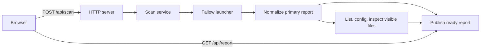

# Architecture

Code Shame runs a local HTTP server around Fallow and serves a browser dashboard.
There is no frontend build step. Node.js uses CommonJS in `src`; the browser uses
native ES modules in `public/app`. `public/app/package.json` also lets Node import those
modules directly in tests without changing the backend module format.

## Module boundaries

| Area | Modules | Responsibility |
| --- | --- | --- |
| CLI | `src/start.js` | Reads environment settings, listens on a port, handles shutdown. |
| HTTP | `src/server.js`, `src/paths.js` | Creates a server, routes API requests, serves the public directory and two vendor scripts. |
| Scan lifecycle | `src/scanService.js` | Owns one project's snapshot, active scan, cancellation, and project identity. |
| Process adapter | `src/fallowClient.js` | Runs the installed Fallow launcher, parses JSON, enforces command deadlines, terminates its process tree. |
| Analysis | `src/fallowReport.js`, `src/architectureAnalyzer.js`, `src/concurrency.js` | Normalizes primary results and performs bounded file inspections. |
| Graph model | `src/projectArchitecture.js` | Classifies files, selects a representative subset, builds renderer-independent nodes and edges. |
| Browser bootstrap | `public/app/main.js` | Connects DOM elements, navigation, renderers, and scan controls. |
| Scan controls | `public/app/scan-controller.js` | Owns HTTP requests, polling, auto-refresh timers, busy state, and disposal. |
| Report presentation | `public/app/report.js`, `public/app/overview.js`, `public/app/findings.js`, `public/app/format.js` | Renders report sections, metric charts, and copyable text. |
| Browser state | `public/app/metric-history.js` | Stores up to 24 metric samples per project in localStorage. |
| Graph presentation | `public/app/architecture.js` | Converts the graph model into Cytoscape elements and binds focus/details behavior. |
| UI support | `public/app/navigation.js`, `public/app/icons.js`, `public/app/copy.js`, `public/app/html.js` | Provides navigation, vendor icon integration, clipboard handling, and HTML escaping. |
| Demo | `public/app/demo.js` | Provides sample reports and graph fixtures without writing them to metric history. |

Application modules use explicit imports and exports. Cytoscape and Lucide are
vendor UMD scripts; their globals are used only by their presentation adapters.
The graph model does not depend on Cytoscape or browser APIs.

## Public and server code

`public` is the complete, directly served browser application. Its root holds
`index.html`, `app/` holds JavaScript modules, and `styles/` holds CSS. Keep server-only code and secrets outside it. Static
paths are constrained to this directory. The vendor routes expose only the
resolved Cytoscape and Lucide scripts, not the whole node_modules directory.

`src` contains Node.js code and is not served to the browser. Importing
`src/server.js` exports `createServer(options)` without opening a port or
registering process signal handlers. Each server gets its own scan service;
tests can inject a service at this boundary.

The CLI never reads PID files or stops another process. If its requested port is
occupied, it exits with an error. On SIGINT or SIGTERM it closes its own server;
the server's close event cancels its active scan.

## Scan lifecycle and API

- `GET /api/health` returns `{ ok: true }`.
- `POST /api/scan` starts a scan and returns its snapshot with HTTP 202. Requests
  during an active scan share that work.
- `GET /api/report` returns `projectId`, `state`, `report`, `error`, `startedAt`,
  `finishedAt`, and `running`.

`state` is `idle`, `running`, `ready`, or `failed`. It becomes `ready` as soon as
the primary analysis is available. At that point `report.architecture.state` can
still be `running`, and the top-level `running` remains true. The browser polls
every 1.5 seconds until all analysis settles. `finishedAt` records that moment;
`report.generatedAt` identifies the primary report for metric samples.

An architecture failure produces a local `state: "failed"` graph value and keeps
the primary report. A primary failure sets the snapshot state to `failed` and
retains the previous report when available.

Each command has a 60-second deadline; the entire scan has a 180-second deadline.
Shutdown cancels active commands. The launcher delegates platform, architecture,
libc selection, and binary verification to Fallow. Since it owns a native child,
cancellation terminates the process group on POSIX or uses `taskkill /T` on
Windows. Exit codes 0 and 1 may carry reports; other exit codes and signal exits
are failures.

## Project identity and metric history

The scan service hashes the absolute project root into a stable `projectId`.
The browser stores metrics under `code-shame:metrics:<projectId>`, so projects
served from the same origin do not share comparisons. Repeated polling of the
same report does not add samples. A new report adds a sample even when its
values are unchanged. Corrupt, unavailable, or full storage does not prevent
rendering.

The old metric cookie is deliberately ignored: it has no project identity and
cannot be migrated safely. Auto-refresh preferences remain a shared cookie.
Demo data is displayed without persisting samples.

## Graph construction

The architecture analyzer requests Fallow's file list and resolved config in
parallel, then inspects visible files with four workers. `ARCHITECTURE_MAX_FILES`
defaults to 48; the CLI accepts integers from 1 through 1000.

Configured Fallow boundary zones take precedence over automatic path-based
categories. File selection balances layers and prioritizes entry points,
coupling, size, and low maintainability. Hidden files become summary nodes.

The graph contains `layer`, `file`, and `summary` nodes plus directed `imports`
edges. Layer nodes are compound parents. File nodes carry their paths and
metrics. Import relationships are derived from both `imports_from` and
`imported_by`, with stable ids deduplicating edges between visible files.

`buildProjectArchitecture(plan, inspections)` directly builds the supported node
and edge types. There is no plugin registry or contributor configuration. To add
a graph type, change the builder, its frontend adapter, and their focused tests
together. The renderer uses a deterministic preset layout and fixed node
positions.

## Verification

Run `npm test` for backend CommonJS and frontend ES-module tests. The suite
covers scan publication, deadlines, shutdown, process-tree cancellation, port
conflicts, HTTP routes, report normalization, graph construction, polling, and
per-project metric history. Frontend tests import modules directly.

Run `npm pack --dry-run` to check the distributable. All browser modules and
`public/app/package.json` must be included; no generated assets are required.
