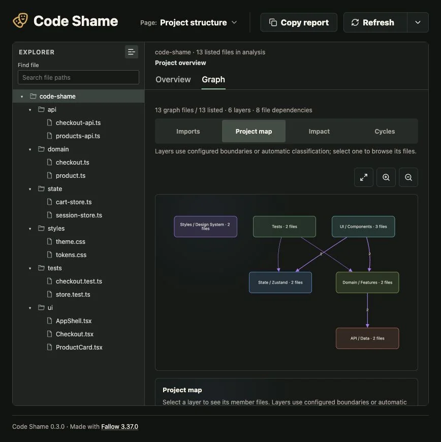
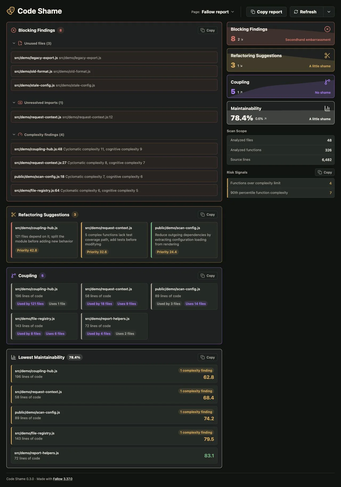

# Code Shame

Local web dashboard for Fallow code analysis reports.

### Project structure



### Fallow report



## Usage

Run it from the root of the project you want to analyze:

```sh
npx code-shame
```

Open the printed local URL, then press **Refresh** to run a scan.

The dashboard starts an initial scan when opened. The report becomes available
before the project map finishes building. Commands time out after 60 seconds and
the whole scan after 180 seconds, so a stalled analysis can be retried.

By default Code Shame listens on `127.0.0.1:5179`. Override it with environment
variables when needed:

```sh
HOST=0.0.0.0 PORT=5180 npx code-shame
```

If the port is occupied, Code Shame reports an error and leaves the existing
process running. Stop that process yourself or choose another port. Ctrl+C
stops this server and its active analysis processes.

Metric history is stored locally in the browser for each analyzed project.
The previous unscoped history cookie is ignored.

## What It Shows

- An interactive project structure map grouped into architectural layers
- Blocking Findings from Fallow checks
- Refactoring Suggestions from maintainability analysis
- Code Health metrics and lowest maintainability files
- Copyable text reports for sharing findings

The project map uses configured Fallow boundary zones when available and falls
back to automatic categories such as styles/design system, state stores, UI,
API/data, domain, tests, server, and tooling. Open it as a separate page from the
toolbar page selector. See [ARCHITECTURE.md](./ARCHITECTURE.md) for the graph model
and extension points.

## Requirements

- Node.js 22 or newer
- A JavaScript or TypeScript project supported by Fallow

Fallow is installed as a package dependency, so users do not need to install it
separately.

### Project structure

The architecture map starts with directed layer-to-layer dependencies. Each edge label counts unique importing-file → imported-file pairs from the project graph, including files hidden by the old display limit. Search a file path and select a match to explore its inbound and outbound dependencies at depth one or two. The focus view limits rendering to 60 files and 300 dependencies and reports shown and total counts; use Back to layers to return. File metrics are shown when available. A partial graph label means dependency counts and results reflect only the data collected.

Choose Impact to see direct consumers and other files reachable through their imports. Choose Cycles to inspect groups of mutually dependent files, including self-imports. These analyses use the entire collected graph before applying display limits; they describe static dependencies, not runtime effects. Imports and imported-by counts use unique directed file pairs, including self-imports, and are separate from Fallow's metrics. In a partial graph, counts are lower bounds except the observed indirect-consumer count, which can change as missing direct dependencies are found. Legacy reports without a project graph cannot provide these analyses.
